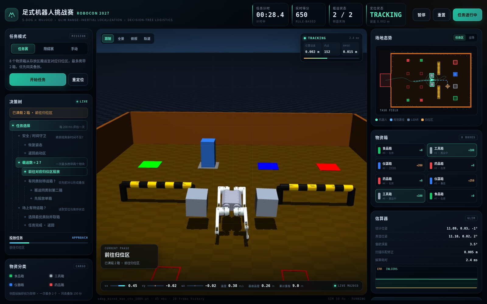

# ROBOCON 2027 足式机器人挑战赛 · MuJoCo 仿真指挥中心

基于 `Robocon2027v4.xml` 场地与 S-Dog 混合地形策略的 Web 仿真器，包含：

- **S-Dog 策略内置**：`sim/assets/sdog_mixed_moe_cts_100k.pt`（45 维观测、10 帧历史、12 关节输出）。
- **GLIM 风格定位**：先验点云地图 + 三层 LiDAR 光线投射 + IMU/腿式里程计预测 + 鲁棒 point-to-line 扫描匹配 + 全局重定位。
- **搬运决策树**：取箱 / 配对 / 投放 / 返回，多任务状态机 + A* 全局路径 + pure-pursuit 跟踪。
- **物资规则**：200 mm 立方箱；机器人侧面接触即判定取物；一次最多携带 2 箱；同类归位、叠放计分。
- **美观 WebUI**：MuJoCo EGL 实时 3D、战术小地图、决策树实时高亮、LiDAR/定位仪表、物资与得分面板。



## 快速开始

```bash
cd /home/zero/Documents/ROBOCON-Legged-Map
./run_sim.sh
```

默认地址：<http://127.0.0.1:8731/>。脚本优先使用
`/home/zero/Documents/sdog_rl_lab/.venv/bin/python`（已包含 `mujoco`、`torch`、`numpy`、`scipy`、`Pillow`）；
也可以通过 `SIM_PYTHON=/path/to/python` 指定环境。

常用参数：

```bash
./run_sim.sh --port 8740 --no-open        # 换端口、不自动打开浏览器
./run_sim.sh --no-autostart               # 打开后先停在待机状态
./run_sim.sh --width 1440 --height 810    # 3D 流分辨率
```

## 操作

| 区域 | 操作 |
| --- | --- |
| 顶部 | `启动自主任务` / `暂停` / `重置` |
| 任务模式 | 任务赛（物资归位）、障碍赛（越障航线）、手动驾驶 |
| 决策树 | 实时显示当前分支、任务状态机、超时进度 |
| 3D 画面 | 拖拽 = 轨道相机，滚轮 = 缩放；`跟随/全景/俯视/轨道` 预设 |
| 手动模式 | `W/S` 前后，`A/D` 横移，`Q/E` 转向，`Shift` 加速，`Space` 停车 |
| 定位 | `重定位` 按钮触发 GLIM 全局分支搜索 |

## 任务赛决策树

```
任务选择
├─ 安全 / 时间守卫
│  ├─ 姿态异常 → 恢复
│  └─ 剩余时间不足 → 返回启动区
├─ 载运数 = 2 ?
│  └─ 前往对应归位区投放（同类两箱自动叠放）
├─ 载运数 = 1 ?
│  ├─ 有同类别待运箱 → 取第二箱（配成叠放）
│  └─ 否则 → 先投放单箱
└─ 场上有待运箱 ?
   ├─ 选择最优类别 / 最近箱体 → 取箱
   └─ 全部完成 → 返回
```

每次任务结束后重新评估；取箱失败会换侧重试，仍失败则对箱体做短时冷却并重新选择。
路径使用 0.1 m 占据栅格 A*，障碍物按机器人半径膨胀；跨越挡车杆时强制走 1 m 中央通道，
避免平滑后的斜线让四足后腿扫到挡杆。

## 搬运与计分

| 项目 | 实现 |
| --- | --- |
| 取物 | 目标箱进入机器人侧方 0.12–0.60 m 的侧向包络即吸附；不要求机械臂动作 |
| 携带 | 左右各 1 箱，共 2 箱；箱体运动学跟随基座，并关闭箱体与机器人的碰撞 |
| 投放 | 机器人进入归位区 0.72 m 内，将箱体放置到区中心；同类第二箱自动叠放 |
| 搬运分 | 箱体离开初始存放区 0.16 m 后 +100 |
| 归位分 | 完全位于同色归位区内 +100；压线 +50 |
| 叠放分 | 同类上箱由下箱稳定支承 +150 |
| 错误区 | 放入非对应颜色归位区 −20 |
| 挡车杆 | 仅在真正越过时 +100（当前策略不会主动跳杆，因此一般不计） |

计分实时计算并显示在右上角；赛时 180 s。最大理论分 1900（与规则书一致）。

本机实测（2026-11-17，RTX 4090 / EGL）：任务赛在 **121.6 s** 内完成全部 8 箱，
得到 **1800 / 1800**（4 组同类叠放，未跳挡车杆），GLIM 定位误差约 **5 cm**。

## GLIM 风格定位

真正的 [GLIM](https://github.com/koide3/glim) 使用 GPU 加速的 3D range-inertial 因子图。本项目把同样的估计结构压缩到可在 MuJoCo 旁实时运行的 2.5D 版本：

1. **先验地图**：从静态场地几何采样垂直面点与法向，建立 KD-tree 和 2D 距离场；机器人与物资箱不进入先验地图。
2. **IMU / 里程计因子**：50 Hz 用基座速度 + IMU 姿态得到的世界偏航角速度预测位姿，并注入陀螺零偏与速度噪声。
3. **Range 因子**：10 Hz、三层 360 线虚拟 LiDAR（`mj_ray`）生成机体坐标系扫描；与先验地图做鲁棒 point-to-line Gauss-Newton 匹配（Cauchy 权、距离门限、雅可比解析）。
4. **一致性守卫**：单帧修正限幅、RMSE/内点门限、连续跟踪的 `last_good_pose` 回退。
5. **全局重定位**：粗网格 × 24 偏航角分支搜索，候选按距离/朝向连续性筛选，再 ICP 精化；按钮可手动触发。
6. **可视化**：LiDAR 点、估计轨迹、真值误差、内点数和 RMSE 均实时显示；真值只用于评估，不参与控制。

> 说明：当前实现是“GLIM 风格”的轻量级进程内定位器，不是 GLIM ROS2 包的移植；如果后续要接真实
> Livox/IMU 数据，可把 `sim/localization.py` 的 `LidarScanner` 替换为真实驱动，估计器接口保持不变。

## 场景与模式

`Robocon2027v4.xml` 内含两个相邻场地：

- 左侧 **14 m × 6 m 障碍赛场地**：绕桩、限高框架、高墙、沟壑组合、砖木坑、轮胎阵、梅花桩、单木桥。
- 右侧 **6 m × 4 m 任务赛场地**：8 个存放位、4 个归位区、2 个挡车杆，通过 1 m 西侧开口与障碍场相连。

| 模式 | 起点 | 行为 |
| --- | --- | --- |
| 任务赛 | (7.6, 0) 任务启动区 | 8 箱搬运 / 归位 / 叠放，决策树自主运行 |
| 障碍赛 | (0, 0) 启动区 1 | 沿 8 个障碍的检查点航线行进；**这是演示航线，不是裁判级越障判定** |
| 手动 | (7.6, 0) | 键盘/触屏自由驾驶，可用于观察地形和测试定位 |

## HTTP API（便于二次开发）

| 方法 | 路径 | 说明 |
| --- | --- | --- |
| GET | `/api/state` | 10 Hz 遥测（位姿、定位、物资、决策、路径、日志） |
| GET | `/api/config` | 物资/归位区/决策树/模式/相机配置 |
| GET | `/map.png` | 战术地图底图 |
| GET | `/frame.jpg` / `/stream.mjpg` | MuJoCo 3D 画面 |
| POST | `/api/mission` | `{"action":"start\|pause\|resume\|reset\|relocalize"}` |
| POST | `/api/mode` | `{"mode":"logistics\|obstacle\|manual"}` |
| POST | `/api/camera` | `{"mode":"chase\|top\|wide\|orbit"}` 或 `orbit_delta` |
| POST | `/api/keys` | 手动模式按键集合 |

## 目录

```
Robocon2027v4.xml                     原始场地地形
2027年足式机器人挑战赛-V2.0.pdf...     原始规则书
run_sim.sh                            启动脚本
sim/
  app.py                              HTTP 服务 + 实时仿真主循环
  scene.py                            场地 + S-Dog + 物资箱场景合成
  robot.py                            S-Dog 策略 / 观测 / PD
  cargo.py                            取物、携带、投放、叠放
  localization.py                     GLIM 风格定位
  planning.py                         占据栅格 A* + pure pursuit
  mission.py                          决策树 / 任务状态机 / 规则计分
  render.py                           EGL 3D 渲染线程
  minimap.py                          战术地图底图
  web/                                WebUI（HTML/CSS/JS）
  assets/                             场地、机器人、策略、网格
```

## 测试与验证

```bash
# 场景与策略冒烟（无渲染）
python -m sim.scene
python - <<'PY'
import sys; sys.path.insert(0, '.')
import mujoco
from sim.robot import SdogPolicy
from sim.config import POLICY
m = mujoco.MjModel.from_xml_path('sim/assets/scene.xml')
d = mujoco.MjData(m)
SdogPolicy(m, d, POLICY)
print('loaded', m.ngeom, 'geoms', m.nu, 'actuators')
PY
```

实测：1280×720 渲染约 25–30 fps，物理与策略实时；定位单帧约 1–4 ms。障碍赛航线约 32 s 可得 900 分，
开阔区域 LiDAR 特征稀疏时定位会进入 `DEGRADED / LOST` 并自动重定位；该模式是航线演示，不是裁判级判定。
首次启动会生成 `sim/assets/scene.xml`（约 188 KB），之后复用。

## 设计假设

- 规则书只为**任务赛**定义了 200 mm 物资箱、8 个存放位和 4 个归位区，因此物资搬运决策树放在
  6 m × 4 m 任务赛场地；障碍赛模式负责 14 m × 6 m 场地的越障航线演示。若需要把 8 个箱子直接
  散布到障碍场自由地面，只需改 `sim/config.py` 的 `STORAGE` 和作业点位，决策树/A* 无需重写。
- “GLIM 定位”实现为可在 MuJoCo 旁实时运行的 **GLIM 风格 2.5D range-inertial 定位器**，不是
  GLIM ROS2/CUDA 包的移植；接口在 `sim/localization.py`，可替换为真实 LiDAR/IMU 驱动。
- 不实现机械臂抓取；规则要求只判定“取物/归位”，因此采用侧面接触吸附 + 归位区中心释放的简化模型。
- 挡车杆 100 分只在真实越过时判定；当前四足策略不会主动跳杆，因此演示通常以 1800 分结束。

## 已知限制

- 障碍赛模式是“检查点航线演示”，未实现规则书表 2 中按足端接触/平面投影的裁判级越障判定。
- 取放为简化模型：侧面接触吸附、归位区中心释放、上箱直接叠放；没有机械臂关节与抓取力。
- 物资箱与机器人碰撞被隔离（避免把 0.3 kg 纸箱踢飞），但箱体彼此、箱体与地面有碰撞，可稳定叠放。
- 场地障碍顺序与尺寸来自 XML；规则书允许的 5% 尺寸误差未额外随机化。
- 任务赛区的挡车杆需要跨越才能拿 100 分；当前四足策略不主动跳杆，因此该项通常为 0。

## 参考

- 规则书：`2027年足式机器人挑战赛-V2.0.pdf...`
- 场地：`Robocon2027v4.xml`
- S-Dog baseline：`/home/zero/Documents/sdog_rl_lab/baseline/velocity`
- GLIM 论文：<https://arxiv.org/abs/2407.10344>
